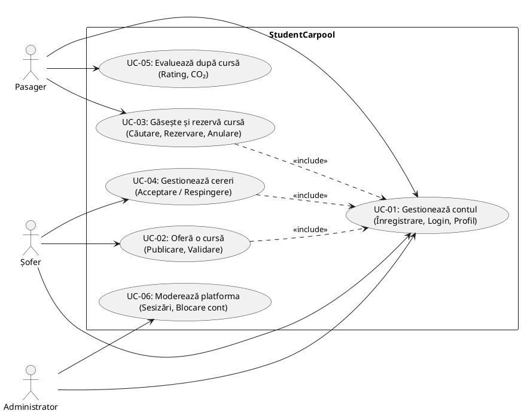

# Requirements Document – StudentCarpool

**Universitatea din București – Facultatea de Matematică și Informatică**  
**Proiect:** StudentCarpool (Aplicație de carpooling interurban dedicată comunității studențești)  
**Autor:** Răcuciu Cosmin (Product Owner)  
**An universitar:** 2026–2027  

---

## 1. Descrierea problemei abordate

În fiecare săptămână, sute de mii de studenți din România efectuează deplasări pe rute interurbane majore (cum ar fi București – Brașov, București – Constanța, Cluj-Napoca – Oradea sau Iași – București) pentru a se întoarce acasă în weekenduri, în vacanțe sau pentru activități academice.

Mijloacele de transport în comun tradiționale (trenurile CFR și autocarele) se confruntă cu neajunsuri majore:
* **Aglomerația cronică și lipsa locurilor:** Vineri (la plecare) și duminică/luni (la întoarcere), biletele se epuizează rapid, iar călătoriile se fac adesea în condiții improprii sau cu întârzieri.
* **Costurile ridicate:** Tarifele pun presiune pe bugetele limitate ale studenților.
* **Ineficiența resurselor:** Mii de autoturisme personale circulă pe aceleași rute cu un singur ocupant (șoferul), generând poluare și aglomerație rutieră.
* **Lipsa de încredere pe platformele comerciale:** Aplicațiile generale de carpooling nu verifică statutul de student și percep comisioane care descurajează tinerii.

**Soluția propusă (StudentCarpool):** O platformă software dedicată exclusiv mediului universitar. Prin validarea obligatorie a identității pe baza adresei de email instituționale (oferită de universități, ex. `@s.unibuc.ro`), eliminăm anonimatul și creăm o comunitate sigură de călătorie între colegi.

---

## 2. Utilizatori și Categoriile de Utilizatori

| Categorie | Descriere | Nevoi Principale | Use Case-uri |
|---|---|---|:---:|
| **Student (rol general)** | Orice persoană cu un cont universitar verificat; poate fi alternativ șofer și pasager cu același cont. | Cont securizat, administrare profil, raportare abuzuri. | UC-01 |
| **Pasager** | Student care caută un loc de călătorie pe o rută interurbană. | Căutare rapidă de curse, rezervare loc, urmărire status cerere, evaluare șofer la final. | UC-03, UC-05 |
| **Șofer** | Student care deține un autoturism și oferă locurile libere pentru a-și amortiza costurile de drum. | Publicare cursă, controlul pasagerilor acceptați în mașină, comunicare status. | UC-02, UC-04 |
| **Administrator** | Moderator al platformei; menține siguranța comunității. | Vizualizare sesizări, suspendare sau blocare conturi abuzive. | UC-01, UC-06 |
| **Utilizator Neverificat (Guest)** | Vizitator care nu și-a confirmat încă adresa universitară. | Acces restricționat strict la pagini informative și termeni de utilizare. | – |

---

## 3. Product Goal

> **„O platformă sigură și ieftină unde studenții verificați își găsesc sau oferă locuri în mașină pentru drumuri interurbane.”**

Product Goal-ul ghidează toate cerințele din backlog pe trei direcții:
1. **Siguranță și Încredere:** Acces condiționat strict de emailul universitar validat.
2. **Eficiență Financiară:** Împărțirea transparentă a costurilor de combustibil fără comisioane ascunse.
3. **Comunitate:** Potrivirea predictibilă a cererii și ofertei între studenți pe rutele de navetă.

---

## 4. Cerințe Funcționale

| ID | Cerință | Prioritate | Use Case | User Story | În Sprint 1 |
|---|---|:---:|:---:|:---:|:---:|
| **FR-01** | Înregistrare permisă doar cu adresă de email din domenii universitare acceptate | Must | UC-01 | US-01 | **DA** |
| **FR-02** | Autentificare și deconectare securizată | Must | UC-01 | US-02 | **DA** |
| **FR-03** | Publicare cursă (origine, destinație, dată/oră, locuri, preț) cu validare server-side | Must | UC-02 | US-03 | **DA** |
| **FR-04** | Căutare curse după filtre (oraș plecare, destinație, dată) | Must | UC-03 | US-04 | **DA** |
| **FR-05** | Rezervare loc: cererea intră în starea `pending`, scade locurile libere | Must | UC-03 | US-05 | **DA** |
| **FR-06** | Șoferul acceptă sau respinge cererile de rezervare primite | Must | UC-04 | US-06 | **DA** |
| **FR-07** | Pasagerul își anulează rezervarea înainte de plecare; locul se eliberează | Must | UC-03 | US-07 | **DA** |
| **FR-08** | Vizualizare curse proprii (șofer) și rezervări proprii (pasager) cu stările lor | Must | UC-03, UC-04 | US-08a, US-08b | **DA** |
| **FR-09** | Șoferul editează sau anulează o cursă; rezervările active se anulează automat | Should | UC-02 | US-09 | NU |
| **FR-10** | Utilizatorul își editează profilul (nume, telefon, universitate) | Should | UC-01 | US-10 | NU |
| **FR-11** | Calculator cost estimat per pasager pentru o cursă | Should | UC-03 | US-11 | NU |
| **FR-12** | Pasagerul evaluează șoferul după cursă (notă 1-5); media este vizibilă la căutare | Should | UC-03, UC-05 | US-12, US-13 | NU |
| **FR-13** | Filtrare curse după preț maxim și interval orar | Should | UC-03 | US-14 | NU |
| **FR-14** | Notificări interne privind schimbarea stării unei rezervări | Should | UC-04 | US-15 | NU |
| **FR-15** | Administrare: blocare conturi abuzive și panou de vizualizare a sesizărilor | Should / Could | UC-06 | US-16, US-17 | NU |
| **FR-16** | Calcul și afișare estimare CO₂ economisit | Could | UC-05 | US-20 | NU |
| **FR-17** | Publicare curse recurente pe calendar | Could | UC-02 | US-19 | NU |
| **FR-18** | Resetare parolă prin link temporar pe email | Could | UC-01 | US-21 | NU |
| **FR-19** | Raportare utilizator pentru comportament neadecvat | Could | UC-01, UC-06 | US-18 | NU |

---

## 5. Cerințe Nefuncționale

| ID | Categorie | Cerință | Mod de Verificare |
|---|---|---|---|
| **NFR-01** | Securitate | Parolele sunt stocate sub formă de hash securizat (argon2id). | Inspecția configurării modulului de autentificare |
| **NFR-02** | Securitate | Autorizarea se verifică pe server la fiecare acțiune; identitatea utilizatorului provine din sesiune, nu din payload-ul de la client. | Code review și teste de endpoint |
| **NFR-03** | Securitate | Toate datele primite sunt validate pe server, independent de validările din interfață. | Teste unitare pe funcțiile pure de domeniu |
| **NFR-04** | Confidențialitate (GDPR) | Colectare minimă de date (email, nume, universitate, telefon opțional); posibilitate de modificare și ștergere. | Revizuire schemă și testare manuală |
| **NFR-05** | Performanță | Căutarea curselor răspunde în sub 2 secunde pentru seturi de până la 1.000 de curse în mediul de dezvoltare. | Măsurare cu date de test |
| **NFR-06** | Utilizabilitate | Interfața este responsive (adaptabilă de la lățimi de 360px), iar mesajele de eroare sunt clare. | Verificare manuală |
| **NFR-07** | Localizare | Interfața este pregătită pentru localizare bilingvă (română / engleză). | Verificare vizuală |
| **NFR-08** | Compatibilitate | Funcționează pe versiunile curente ale browserelor majore (Chrome, Firefox, Safari, Edge). | Verificare pe browsere de desktop și mobil |
| **NFR-09** | Portabilitate | Aplicația poate fi clonată și pornită local urmând pașii din README. | Rulare de către fiecare membru al echipei |
| **NFR-10** | Mentenanță | Codul respectă standardele de linting și formatare; orice modificare intră prin Pull Request cu review. | Verificări automate în pipeline CI |
| **NFR-11** | Integritate Date | Baza de date impune chei străine și unicitatea rezervărilor active per utilizator și cursă. | Schema relațională Drizzle ORM |

---

## 6. Diagrama Cazurilor de Utilizare (Use Case Diagram)

---

## 7. Ipoteze și Limite ale Proiectului

* Se acceptă exclusiv o listă configurabilă de domenii universitare autorizate (`@s.unibuc.ro`, `@stud.acs.upb.ro`, etc.).
* Plățile online cu cardul nu fac parte din scopul MVP-ului; împărțirea costurilor este informativă, decontarea făcându-se direct între studenți.
* Sistemul de chat în timp real și notificările push native pe mobil sunt planificate pentru etape ulterioare.
