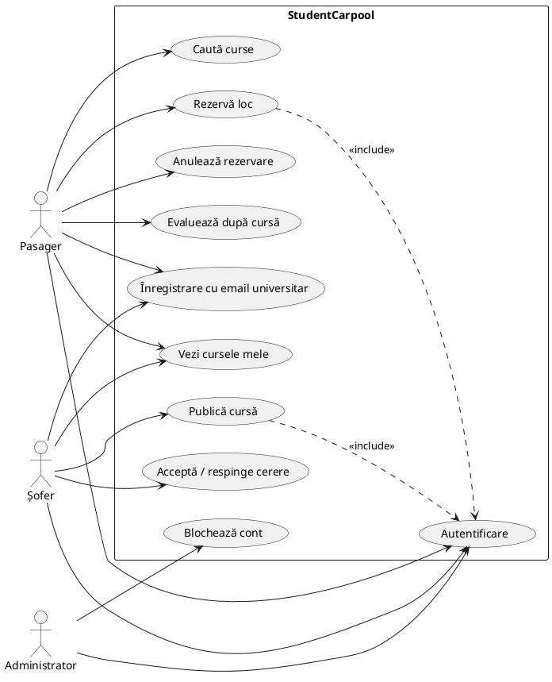

# Requirements Document – StudentCarpool

Acest document definește specificațiile funcționale și arhitecturale ale aplicației StudentCarpool, stabilit de Product Owner și validat de echipă.

## 1. Descrierea problemei
Studenții fac frecvent naveta între orașul universitar și orașul de acasă (de exemplu București ↔ Brașov, Cluj, Iași). Trenurile și autocarele sunt aglomerate sau scumpe, iar multe mașini circulă cu locuri libere. Platformele generale de carpooling nu oferă încredere că ceilalți călători sunt din aceeași comunitate. Există nevoia unei platforme dedicate studenților, în care utilizatorii sunt verificați prin emailul universitar.

## 2. Utilizatori
| Utilizator | Descriere |
|---|---|
| **Pasager** | Student care caută un loc într-o mașină pentru un drum interurban |
| **Șofer** | Student cu mașină care publică curse și acceptă pasageri |
| **Administrator** | Moderează platforma: blochează conturi abuzive, vede sesizări |

Un student poate fi alternativ șofer și pasager (același cont).

## 3. Product Goal
> O platformă sigură și ieftină unde studenți verificați își găsesc sau oferă locuri în mașină pentru drumuri interurbane.

## 4. Cerințe funcționale
| ID | Cerință | User Story |
|---|---|---|
| FR-01 | Înregistrare permisă doar cu email universitar | US-01 |
| FR-02 | Autentificare și deconectare | US-02 |
| FR-03 | Publicarea unei curse (origine, destinație, dată/oră, locuri, preț) cu validări | US-03 |
| FR-04 | Căutarea curselor după oraș și dată | US-04 |
| FR-05 | Rezervarea unui loc, fără dublă rezervare și fără depășirea locurilor | US-05 |
| FR-06 | Șoferul acceptă sau respinge cereri | US-06 |
| FR-07 | Pasagerul anulează rezervarea, locul se eliberează | US-07 |
| FR-08 | Vizualizarea curselor și rezervărilor proprii | US-08 |
| FR-09 | Editarea/anularea unei curse | US-09 |
| FR-10 | Editarea profilului | US-10 |
| FR-11 | Calculator de cost per pasager | US-11 |
| FR-12 | Rating după cursă și afișarea mediei | US-12, US-13 |
| FR-13 | Filtrare după preț și oră | US-14 |
| FR-14 | Notificări la schimbarea stării rezervării | US-15 |
| FR-15 | Administrare: blocare conturi, vizualizare sesizări | US-16, US-17 |
| FR-16 | CO₂ economisit | US-20 |

## 5. Cerințe nefuncționale
| ID | Cerință |
|---|---|
| NFR-01 | Parolele sunt stocate cu hash (argon2id – deja în baseline) |
| NFR-02 | Datele personale se tratează conform GDPR (minimizare, posibilitate de ștergere cont) |
| NFR-03 | Interfața este utilizabilă pe telefon (responsive) |
| NFR-04 | Regulile de business sunt acoperite de teste automate (țintă de coverage stabilită în DoD) |
| NFR-05 | Interfața disponibilă în română și engleză (i18n din baseline) |

## 6. Elemente de inovare (de ales/validat cu profesorul)
1. Comunitate verificată prin domeniul emailului universitar (US-01).
2. Calculator de împărțire a costurilor între pasageri și șofer (US-11).
3. Afișarea traseului pe hartă, refolosind componenta de hartă din baseline (opțional).
4. Estimare CO₂ economisit (US-20).

## 7. Use Case Diagram (PlantUML – lipiți în plantuml.com sau draw.io)

## 8. Ipoteze și limite
- Se acceptă o listă de domenii universitare configurabilă (`ALLOWED_UNIVERSITY_DOMAINS`).
- Plățile nu sunt incluse; prețul este informativ, plata se face între utilizatori.
- Chat-ul și notificările push sunt în afara sprintului.
